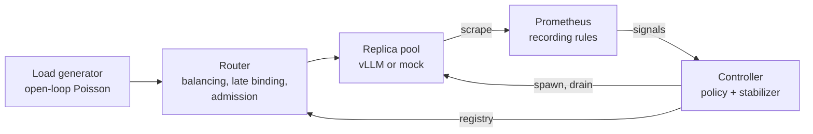
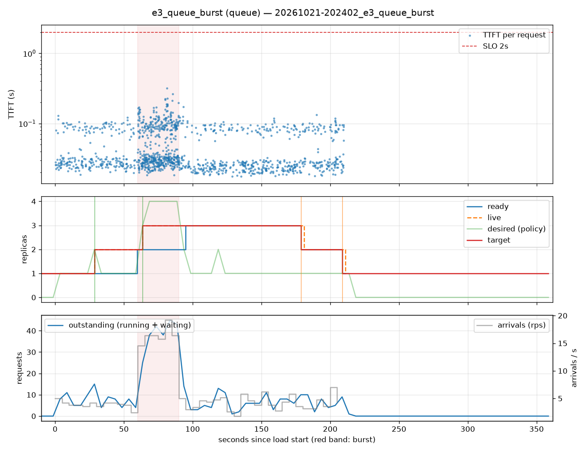
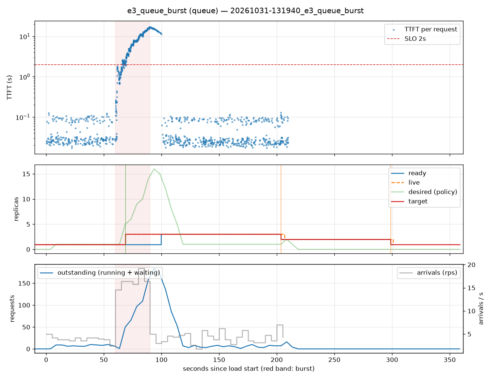
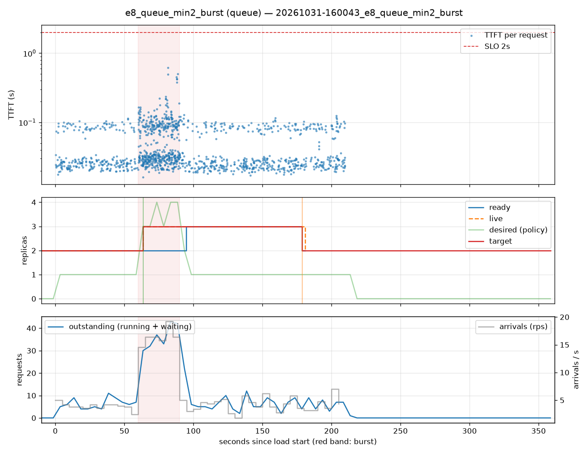
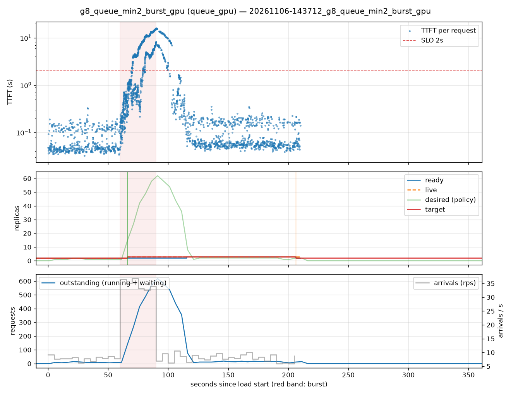

# Inference SLO Autoscaler

Autoscaling LLM serving on queue-derived signals instead of GPU utilization —
and what it can and can't do when a burst is shorter than a cold start.

**Short version.** GPU utilization reads ~97% whenever an LLM server is doing
anything, so it can't tell light load from overload. Scaling on outstanding
requests is the right signal, but on a 30-second burst it still lost: new
replicas took 31 s (mock) to 37 s (real vLLM) to start, so capacity arrived
after the burst ended, in every run that didn't get lucky. What protected the
SLO was paying for it deliberately: standing headroom met it in 3/3 runs, and
admission control capped the worst case at 1.5 s. Then real hardware added a
caveat the simulator couldn't: **two vLLM replicas sharing one GPU delivered
~11 rps combined, less than one replica alone (~15).** Headroom only works if
it's real hardware.

## The question

LLM serving breaks the usual autoscaling assumptions. The GPU looks busy at
any load, capacity depends on how much KV memory requests hold, and time to
first token (TTFT) is dominated by queueing. So:

1. Is GPU utilization a usable scaling signal? (No.)
2. Is a queue-derived signal better? (Yes, but not enough on its own.)
3. When capacity can't arrive in time, what actually protects the SLO?

SLO: p95 TTFT ≤ 2 s. Workload: a 60 s baseline, a 30 s burst at 1.7× one
replica's capacity, 120 s of recovery. 70% short prompts (100–300 tokens),
30% long (2,000–3,500).

## System



- **Mock replica** — a continuous-batching simulator (admission, chunked
  prefill, KV blocks, preemption) behind vLLM's API and metric names, so
  everything was developed on a laptop.
- **Router** — least-outstanding balancing, streaming relay, optional late
  binding (one router-side queue; dispatch only when a replica has a free
  slot) and admission control (429 when the queue is full or a request has
  waited too long).
- **Controller** — reads recording rules from Prometheus, runs a pure policy
  and a shared stabilizer, and owns replica lifecycle: health checks, warmup,
  drain-before-terminate, crash replacement.
- **Load generator** — open-loop (no coordinated omission), seeded, and
  self-validating: a run is invalid if its own dispatch lags, it hits its
  connection limit, requests are censored at drain, the error rate exceeds 1%,
  or the host was suspended mid-run.
- **Experiment runner + analysis** — one command per run, a self-describing
  results directory, per-run timelines, and a comparison grouping repeats.

Design and every decision with its reason: [`docs/ARCHITECTURE.md`](docs/ARCHITECTURE.md),
[`docs/HANDOFF.md`](docs/HANDOFF.md).

## Results on the simulator (3 runs each)

| Policy | Burst p95 TTFT | Within SLO | Ready at onset | Cost (replica·s) |
|---|---|---|---|---|
| HPA on GPU util, 99% target | 15.6–15.8 s | 19–20% | 1 | 210 |
| HPA on GPU util, 80% target | 116–119 ms | 100% | 2 | 583–593 |
| Queue (outstanding requests) | 145 ms – 15.6 s | 20–100% | 1–2 | 490–509 |
| Predictive (arrival rate + projected queue) | 224 ms – 15.6 s | 20–100% | 1–2 | 494–511 |
| Queue + late binding | 216 ms – 13.9 s | 12–100% | 1–2 | 462–504 |
| Queue + late binding + shed after 1.5 s | **144 ms – 1.49 s** | 93–100% (0–6% shed) | 1–2 | 470–480 |
| Queue + floor of 2 replicas | **145–173 ms** | **100%** | 2 | 533–537 |

Full table: [`results/comparison.md`](results/comparison.md).

**1. GPU utilization carries no load information.** It read ~97% at a 4 rps
baseline and at a 14 rps overload alike. At an 80% target the HPA formula
scaled up during the quiet baseline and "won" by over-provisioning; at 99% it
never scaled. No threshold on this signal measures load.

**2. A better signal didn't protect a short burst.** Detection took ~5–10 s,
the cold start 31 s; capacity landed 4.7–9.8 s *after* the burst ended in every
run that scaled only after onset. The queue and predictive policies each met
the SLO in one of three runs — the runs where baseline noise had already
crossed their threshold. Same arrivals, opposite outcomes.




**3. Late binding makes late capacity useful, not early.** Without it, a
backlog stays pinned to the replica that received it; new replicas only take
new arrivals. With one router-side queue, recovery p95 fell from 14.3 s to
6.4 s. Burst p95 barely moved: the capacity still arrived late.

**4. Admission control bounds the worst case.** Shedding requests that had
waited 1.5 s kept every run under 1.5 s p95, at 0–6% shed. A bad burst becomes
a small number of fast rejections instead of everyone waiting 15 s.

**5. Headroom is the reliable answer, at a known price.** A floor of two
replicas met the SLO in every run, ~10% cheaper than the util-80% baseline that
stumbled into the same result, and ~10% more than reactive scaling alone.



## Results on real vLLM (RTX A5000, 2 runs each)

Qwen2.5-0.5B-Instruct, vLLM 0.33.0, three replicas' worth of memory
(`--gpu-memory-utilization 0.28` each) on one 24 GB GPU.

| Measurement | Value |
|---|---|
| Cold start, first launch on a machine | ~115 s (kernel and compile caches) |
| Cold start, warm, idle GPU | 36–37 s |
| Cold start, warm, while the GPU serves a burst | 48–49 s |
| One replica's capacity (sweep) | ~20 rps; ~15–16 rps under burst |
| **Two co-located replicas, combined** | **~11.3–11.5 rps** |
| KV cache per replica | 404,992 tokens (never the bottleneck) |

| Experiment | Ready at onset | Burst p95 | Within SLO | Cost (replica·s) |
|---|---|---|---|---|
| Queue, starting at 1 replica | 1 | 13.4–13.6 s | 33–34% | 316–318 |
| Queue, floor of 2 replicas | 2 | 13.5–14.7 s | 45–47% | 563–564 |

**6. Replicas sharing one GPU aren't capacity.** The headroom result did not
carry over: with two replicas ready at onset, the burst was barely better than
with one, at 1.8× the cost. Measured from queue growth during the burst, two
co-located replicas delivered ~30% *less* throughput than one. The simulator
gave each replica independent hardware, so it couldn't show this. The cause
isn't separated here: the GPU is time-sliced between processes, and the pod's
9 vCPUs were shared by two vLLM engines plus the router, controller,
Prometheus, and load generator.

**7. Concurrent starts fail on a shared GPU.** When the queue policy scaled
from 1 to 3, both new vLLM processes saw 2.34 GiB free against the 6.59 GiB
each was configured for, and refused to start. The controller replaced them
two at a time, and they failed again. One replica served the whole burst — and
given finding 6, a second one there would likely have made things worse.



## What this means

- Don't autoscale LLM serving on GPU utilization.
- Scale on outstanding requests, but don't expect reactive scaling to save a
  burst shorter than your cold start. Measure that cold start under load, not
  idle.
- Buy reliability explicitly: headroom for the bursts you must absorb,
  admission control for the ones you can't, late binding so either works.
- Headroom means separate GPUs. Stacking replicas on one GPU multiplies
  memory and processes, not throughput — and their simultaneous starts can fail.

## Limitations

- The simulator's parameters were set by hand, not calibrated to the GPU
  (real vLLM was ~2× faster than the mock's placeholder). Its conclusions are
  about mechanisms, not absolute numbers.
- One GPU type, one small model (0.5B), one burst shape.
- 3 runs per policy on the simulator, 2 per experiment on the GPU.
- The single-process load generator saturates near ~40 rps of heavy streams;
  it detected this and marked that sweep invalid.
- Multi-GPU headroom (replicas on separate GPUs) wasn't tested; findings 6
  and 7 say that's the experiment to run next.

## Reproduce

```bash
uv sync
uv run pytest                                  # 156 tests
scripts/dev_observability.sh                   # Prometheus + Grafana (Homebrew)
uv run python -m isa.experiment configs/experiments/e8_queue_min2_burst.yaml
uv run python -m isa.analysis compare
```

GPU runs: `scripts/pod_bootstrap.sh`, `scripts/pod_services.sh`, then the
`g*_gpu` experiments; see `docs/HANDOFF.md` for the pod runbook and its gotchas.

## Things the instrument caught

Every one of these became a check or a test:

- A burst run against stopped replicas returned 726/726 errors and was
  reported **valid**. → error-rate check and a preflight request.
- Every replica crashing made metrics vanish, signals go stale, and the
  stabilizer hold forever at zero. → bounds are checked before staleness.
- A laptop slept 6.5 minutes mid-run; dispatch lag looked perfect because the
  monotonic clock stopped too. → wall-vs-monotonic drift check, and
  `caffeinate` for batches.
- A backlog stayed pinned to one replica after new ones were ready. → late
  binding.
- Identical arrivals gave opposite results. → repeats grouped, reported as
  median and range.