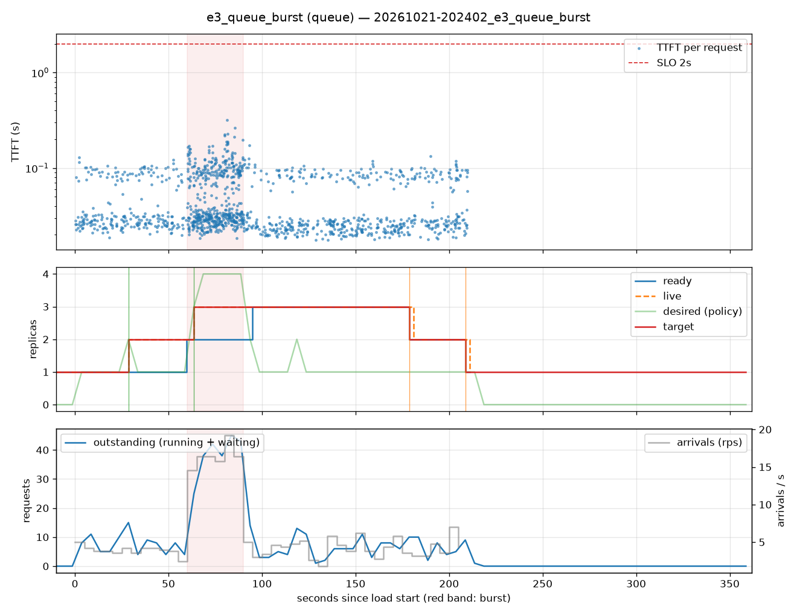

# e3_queue_burst (queue)

Run `20261021-202402_e3_queue_burst`, git `22778e11`, valid: **True**

| Phase | Rate | Requests | OK | TTFT p50 | TTFT p95 | TTFT p99 | Within SLO |
|---|---|---|---|---|---|---|---|
| 0 | 4 rps | 234 | 234 | 29ms | 101ms | 114ms | 100% |
| 1 | 16 rps | 494 | 494 | 34ms | 145ms | 211ms | 100% |
| 2 | 4 rps | 509 | 509 | 27ms | 98ms | 117ms | 100% |

## Burst reaction

- Ready at onset: **2**; scale-ups during baseline: 1
- Detection: 3.61s; capacity ready: 34.77s (burst lasted 30s)
- Capacity arrived after the burst ended by: 4.77s

## Cost and activity

- Replica-seconds during load: **509**
- Peak outstanding: 45; scale-ups 3, scale-downs 2

