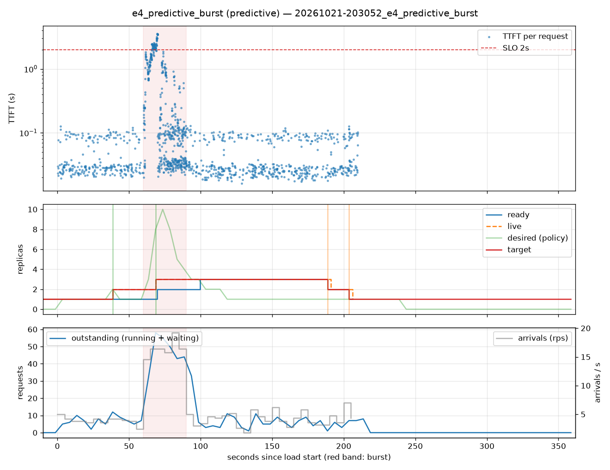

# e4_predictive_burst (predictive)

Run `20261021-203052_e4_predictive_burst`, git `22778e11`, valid: **True**

| Phase | Rate | Requests | OK | TTFT p50 | TTFT p95 | TTFT p99 | Within SLO |
|---|---|---|---|---|---|---|---|
| 0 | 4 rps | 234 | 234 | 29ms | 100ms | 112ms | 100% |
| 1 | 16 rps | 494 | 494 | 115ms | 2.42s | 3.44s | 88% |
| 2 | 4 rps | 509 | 509 | 28ms | 99ms | 114ms | 100% |

## Burst reaction

- Ready at onset: **1**; scale-ups during baseline: 1
- Detection: 8.62s; capacity ready: 39.80s (burst lasted 30s)
- Capacity arrived after the burst ended by: 9.80s

## Cost and activity

- Replica-seconds during load: **500**
- Peak outstanding: 58; scale-ups 3, scale-downs 2

