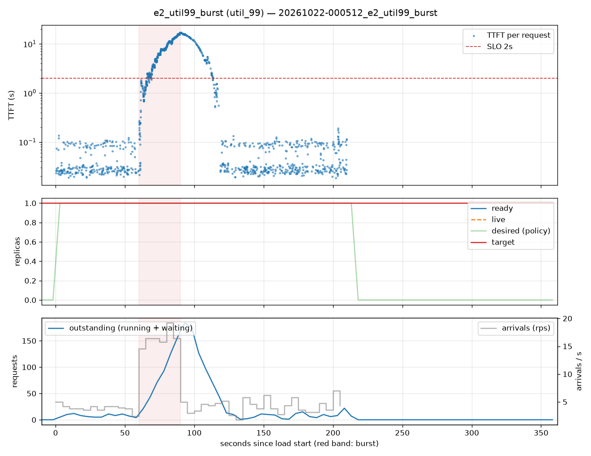

# e2_util99_burst (util_99)

Run `20261022-000512_e2_util99_burst`, git `4f4808a1`, valid: **True**

| Phase | Rate | Requests | OK | TTFT p50 | TTFT p95 | TTFT p99 | Within SLO |
|---|---|---|---|---|---|---|---|
| 0 | 4 rps | 234 | 234 | 29ms | 102ms | 118ms | 100% |
| 1 | 16 rps | 494 | 494 | 6.38s | 15.62s | 16.79s | 20% |
| 2 | 4 rps | 509 | 509 | 52ms | 14.39s | 16.57s | 82% |

## Burst reaction

- Ready at onset: **1**; scale-ups during baseline: 0
- Detection: —; capacity ready: — (burst lasted 30s)
- Capacity arrived after the burst ended by: —

## Cost and activity

- Replica-seconds during load: **210**
- Peak outstanding: 184; scale-ups 1, scale-downs 0

