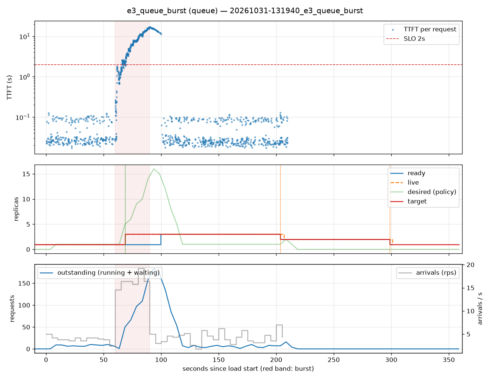

# e3_queue_burst (queue)

Run `20261031-131940_e3_queue_burst`, git `9fe9b961`, valid: **True**

| Phase | Rate | Requests | OK | TTFT p50 | TTFT p95 | TTFT p99 | Within SLO |
|---|---|---|---|---|---|---|---|
| 0 | 4 rps | 234 | 234 | 29ms | 103ms | 116ms | 100% |
| 1 | 16 rps | 494 | 494 | 6.37s | 15.58s | 16.74s | 20% |
| 2 | 4 rps | 509 | 509 | 28ms | 14.33s | 16.51s | 92% |

## Burst reaction

- Ready at onset: **1**; scale-ups during baseline: 0
- Detection: 8.58s; capacity ready: 39.76s (burst lasted 30s)
- Capacity arrived after the burst ended by: 9.76s

## Cost and activity

- Replica-seconds during load: **490**
- Peak outstanding: 184; scale-ups 2, scale-downs 2

