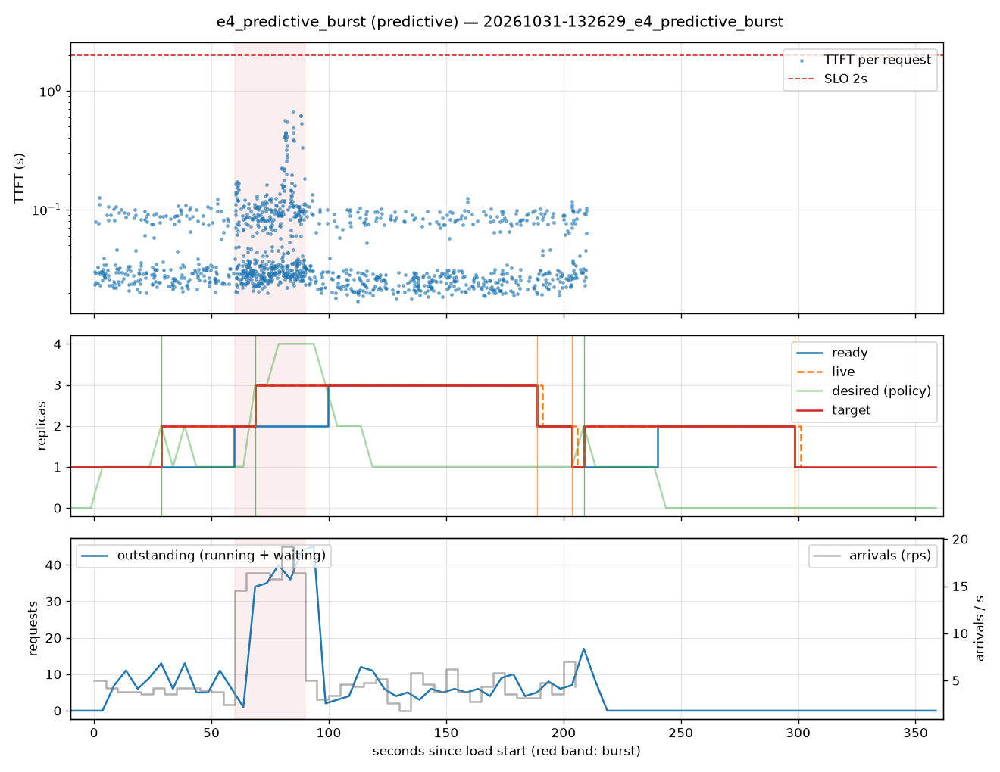

# e4_predictive_burst (predictive)

Run `20261031-132629_e4_predictive_burst`, git `9fe9b961`, valid: **True**

| Phase | Rate | Requests | OK | TTFT p50 | TTFT p95 | TTFT p99 | Within SLO |
|---|---|---|---|---|---|---|---|
| 0 | 4 rps | 234 | 234 | 30ms | 101ms | 111ms | 100% |
| 1 | 16 rps | 494 | 494 | 38ms | 224ms | 530ms | 100% |
| 2 | 4 rps | 509 | 509 | 27ms | 97ms | 109ms | 100% |

## Burst reaction

- Ready at onset: **2**; scale-ups during baseline: 1
- Detection: 8.63s; capacity ready: 39.81s (burst lasted 30s)
- Capacity arrived after the burst ended by: 9.81s

## Cost and activity

- Replica-seconds during load: **511**
- Peak outstanding: 45; scale-ups 4, scale-downs 3

