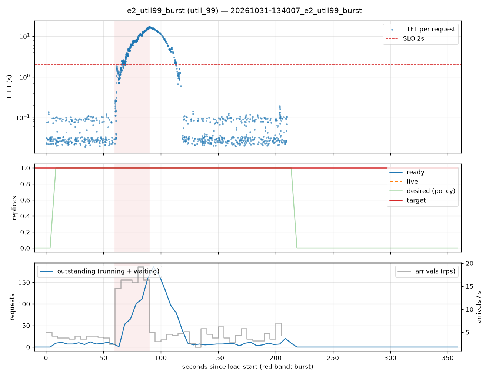

# e2_util99_burst (util_99)

Run `20261031-134007_e2_util99_burst`, git `9fe9b961`, valid: **True**

| Phase | Rate | Requests | OK | TTFT p50 | TTFT p95 | TTFT p99 | Within SLO |
|---|---|---|---|---|---|---|---|
| 0 | 4 rps | 234 | 234 | 29ms | 102ms | 119ms | 100% |
| 1 | 16 rps | 494 | 494 | 6.38s | 15.66s | 16.81s | 20% |
| 2 | 4 rps | 509 | 509 | 50ms | 14.42s | 16.61s | 81% |

## Burst reaction

- Ready at onset: **1**; scale-ups during baseline: 0
- Detection: —; capacity ready: — (burst lasted 30s)
- Capacity arrived after the burst ended by: —

## Cost and activity

- Replica-seconds during load: **210**
- Peak outstanding: 186; scale-ups 1, scale-downs 0

