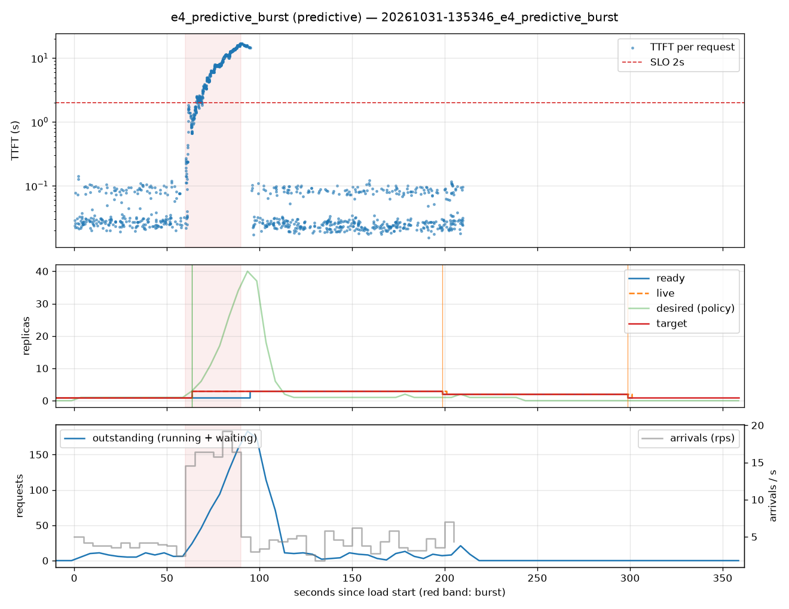

# e4_predictive_burst (predictive)

Run `20261031-135346_e4_predictive_burst`, git `9fe9b961`, valid: **True**

| Phase | Rate | Requests | OK | TTFT p50 | TTFT p95 | TTFT p99 | Within SLO |
|---|---|---|---|---|---|---|---|
| 0 | 4 rps | 234 | 234 | 29ms | 102ms | 117ms | 100% |
| 1 | 16 rps | 494 | 494 | 6.38s | 15.60s | 16.76s | 20% |
| 2 | 4 rps | 509 | 509 | 27ms | 8.80s | 16.53s | 95% |

## Burst reaction

- Ready at onset: **1**; scale-ups during baseline: 0
- Detection: 3.56s; capacity ready: 34.73s (burst lasted 30s)
- Capacity arrived after the burst ended by: 4.73s

## Cost and activity

- Replica-seconds during load: **494**
- Peak outstanding: 183; scale-ups 2, scale-downs 2

