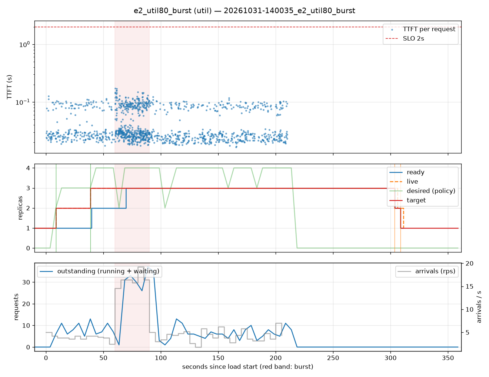

# e2_util80_burst (util)

Run `20261031-140035_e2_util80_burst`, git `9fe9b961`, valid: **True**

| Phase | Rate | Requests | OK | TTFT p50 | TTFT p95 | TTFT p99 | Within SLO |
|---|---|---|---|---|---|---|---|
| 0 | 4 rps | 234 | 234 | 28ms | 100ms | 112ms | 100% |
| 1 | 16 rps | 494 | 494 | 31ms | 117ms | 147ms | 100% |
| 2 | 4 rps | 509 | 509 | 26ms | 97ms | 103ms | 100% |

## Burst reaction

- Ready at onset: **2**; scale-ups during baseline: 2
- Detection: —; capacity ready: — (burst lasted 30s)
- Capacity arrived after the burst ended by: —

## Cost and activity

- Replica-seconds during load: **583**
- Peak outstanding: 37; scale-ups 3, scale-downs 2

