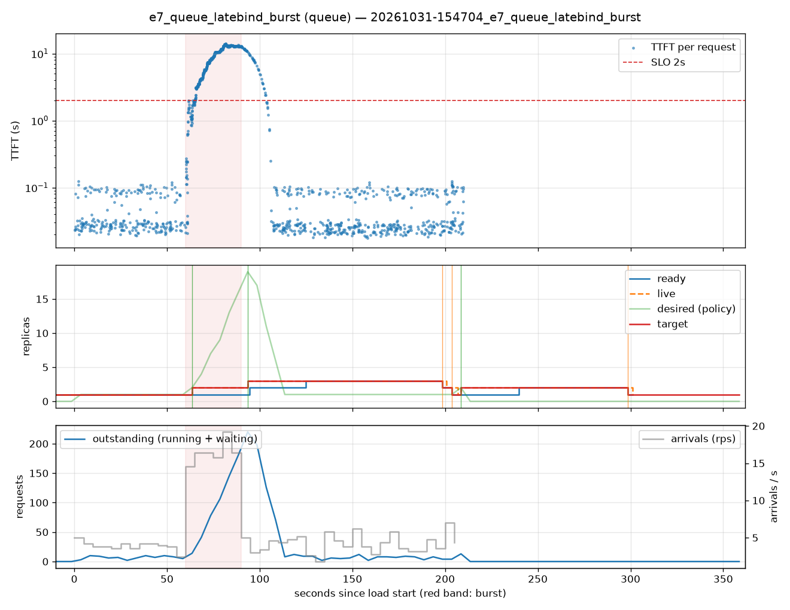

# e7_queue_latebind_burst (queue)

Run `20261031-154704_e7_queue_latebind_burst`, git `c5abdf1e`, valid: **True**

| Phase | Rate | Requests | OK | TTFT p50 | TTFT p95 | TTFT p99 | Within SLO |
|---|---|---|---|---|---|---|---|
| 0 | 4 rps | 234 | 234 | 29ms | 101ms | 111ms | 100% |
| 1 | 16 rps | 494 | 494 | 9.23s | 13.35s | 13.76s | 15% |
| 2 | 4 rps | 509 | 509 | 28ms | 9.11s | 12.25s | 90% |

## Burst reaction

- Ready at onset: **1**; scale-ups during baseline: 0
- Detection: 3.52s; capacity ready: 34.70s (burst lasted 30s)
- Capacity arrived after the burst ended by: 4.70s

## Cost and activity

- Replica-seconds during load: **462**
- Peak outstanding: 220; scale-ups 4, scale-downs 3

