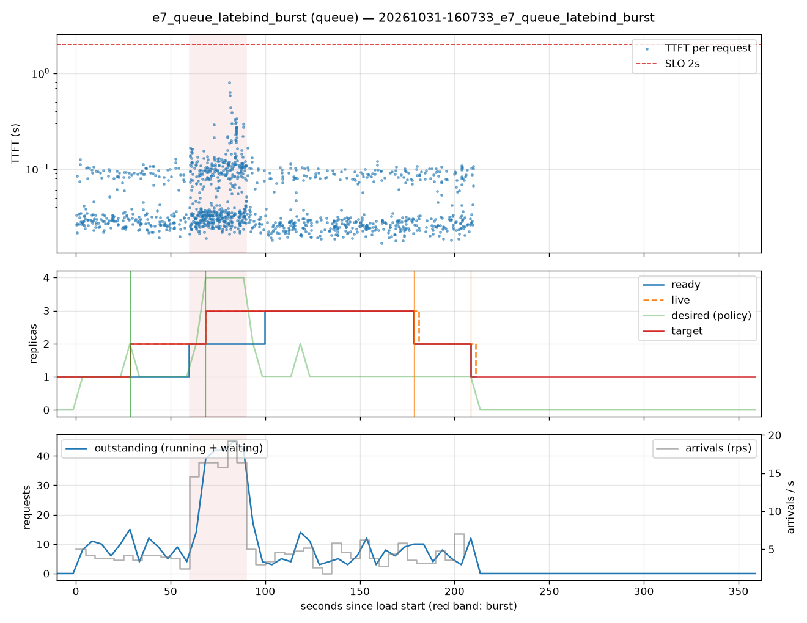

# e7_queue_latebind_burst (queue)

Run `20261031-160733_e7_queue_latebind_burst`, git `c5abdf1e`, valid: **True**

| Phase | Rate | Requests | OK | TTFT p50 | TTFT p95 | TTFT p99 | Within SLO |
|---|---|---|---|---|---|---|---|
| 0 | 4 rps | 234 | 234 | 31ms | 103ms | 116ms | 100% |
| 1 | 16 rps | 494 | 494 | 41ms | 216ms | 338ms | 100% |
| 2 | 4 rps | 509 | 509 | 28ms | 100ms | 109ms | 100% |

## Burst reaction

- Ready at onset: **2**; scale-ups during baseline: 1
- Detection: 8.57s; capacity ready: 39.80s (burst lasted 30s)
- Capacity arrived after the burst ended by: 9.80s

## Cost and activity

- Replica-seconds during load: **504**
- Peak outstanding: 45; scale-ups 3, scale-downs 2

