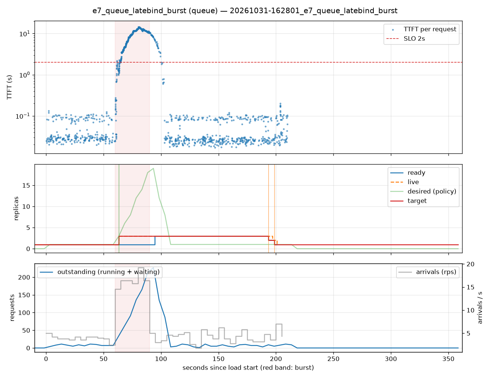

# e7_queue_latebind_burst (queue)

Run `20261031-162801_e7_queue_latebind_burst`, git `c5abdf1e`, valid: **True**

| Phase | Rate | Requests | OK | TTFT p50 | TTFT p95 | TTFT p99 | Within SLO |
|---|---|---|---|---|---|---|---|
| 0 | 4 rps | 234 | 234 | 30ms | 104ms | 117ms | 100% |
| 1 | 16 rps | 494 | 494 | 10.25s | 13.90s | 14.36s | 12% |
| 2 | 4 rps | 509 | 509 | 29ms | 6.38s | 9.98s | 92% |

## Burst reaction

- Ready at onset: **1**; scale-ups during baseline: 0
- Detection: 3.37s; capacity ready: 34.64s (burst lasted 30s)
- Capacity arrived after the burst ended by: 4.64s

## Cost and activity

- Replica-seconds during load: **481**
- Peak outstanding: 227; scale-ups 2, scale-downs 2

