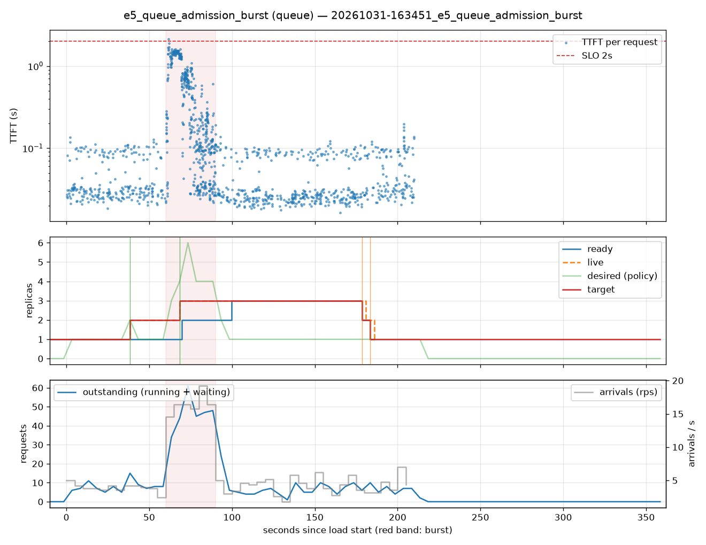

# e5_queue_admission_burst (queue)

Run `20261031-163451_e5_queue_admission_burst`, git `c5abdf1e`, valid: **True**

| Phase | Rate | Requests | OK | TTFT p50 | TTFT p95 | TTFT p99 | Within SLO |
|---|---|---|---|---|---|---|---|
| 0 | 4 rps | 234 | 234 | 31ms | 104ms | 119ms | 100% |
| 1 | 16 rps | 494 | 462 | 213ms | 1.49s | 1.61s | 93% |
| 2 | 4 rps | 509 | 509 | 28ms | 104ms | 137ms | 100% |

## Burst reaction

- Ready at onset: **1**; scale-ups during baseline: 1
- Detection: 8.43s; capacity ready: 39.69s (burst lasted 30s)
- Capacity arrived after the burst ended by: 9.69s

## Cost and activity

- Replica-seconds during load: **470**
- Peak outstanding: 61; scale-ups 3, scale-downs 2

