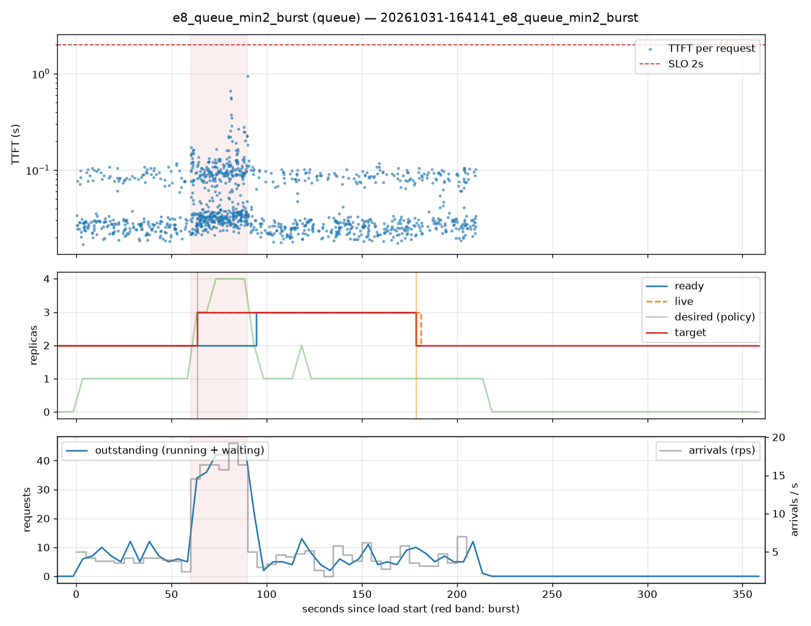

# e8_queue_min2_burst (queue)

Run `20261031-164141_e8_queue_min2_burst`, git `c5abdf1e`, valid: **True**

| Phase | Rate | Requests | OK | TTFT p50 | TTFT p95 | TTFT p99 | Within SLO |
|---|---|---|---|---|---|---|---|
| 0 | 4 rps | 234 | 234 | 28ms | 101ms | 108ms | 100% |
| 1 | 16 rps | 494 | 494 | 39ms | 161ms | 350ms | 100% |
| 2 | 4 rps | 509 | 509 | 28ms | 99ms | 107ms | 100% |

## Burst reaction

- Ready at onset: **2**; scale-ups during baseline: 0
- Detection: 3.42s; capacity ready: 34.65s (burst lasted 30s)
- Capacity arrived after the burst ended by: 4.65s

## Cost and activity

- Replica-seconds during load: **537**
- Peak outstanding: 46; scale-ups 2, scale-downs 1

