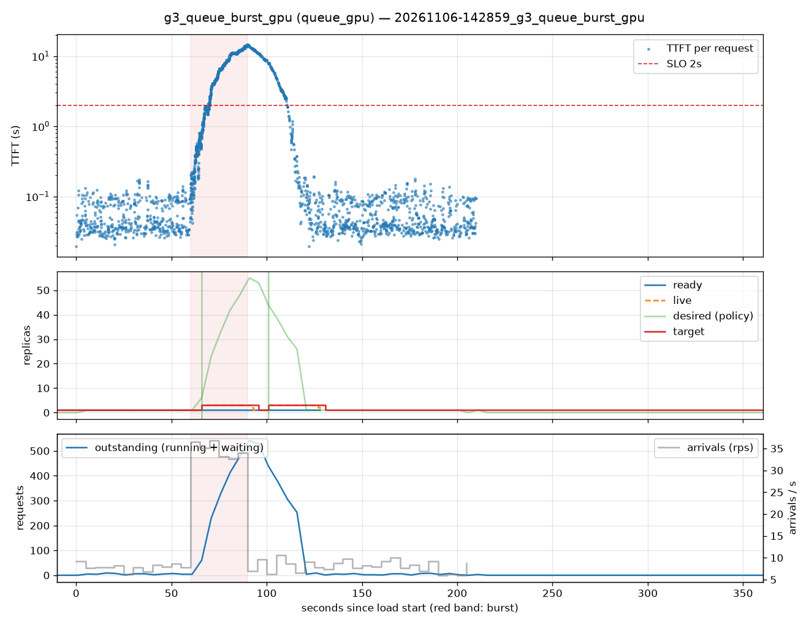

# g3_queue_burst_gpu (queue_gpu)

Run `20261106-142859_g3_queue_burst_gpu`, git `?`, valid: **True**

| Phase | Rate | Requests | OK | TTFT p50 | TTFT p95 | TTFT p99 | Within SLO |
|---|---|---|---|---|---|---|---|
| 0 | 8 rps | 471 | 471 | 43ms | 111ms | 155ms | 100% |
| 1 | 34 rps | 1042 | 1042 | 5.63s | 13.62s | 14.29s | 33% |
| 2 | 8 rps | 968 | 968 | 67ms | 10.59s | 13.43s | 82% |

## Burst reaction

- Ready at onset: **1**; scale-ups during baseline: 0
- Detection: 5.89s; capacity ready: — (burst lasted 30s)
- Capacity arrived after the burst ended by: —

## Cost and activity

- Replica-seconds during load: **316**
- Peak outstanding: 541; scale-ups 3, scale-downs 0

