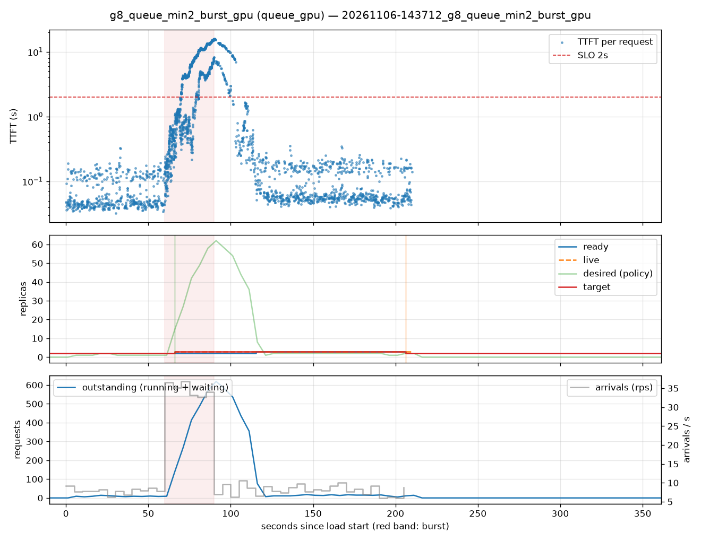

# g8_queue_min2_burst_gpu (queue_gpu)

Run `20261106-143712_g8_queue_min2_burst_gpu`, git `?`, valid: **True**

| Phase | Rate | Requests | OK | TTFT p50 | TTFT p95 | TTFT p99 | Within SLO |
|---|---|---|---|---|---|---|---|
| 0 | 8 rps | 471 | 471 | 49ms | 156ms | 192ms | 100% |
| 1 | 34 rps | 1042 | 1042 | 2.49s | 13.53s | 15.19s | 47% |
| 2 | 8 rps | 968 | 968 | 78ms | 8.25s | 13.62s | 90% |

## Burst reaction

- Ready at onset: **2**; scale-ups during baseline: 0
- Detection: 6.16s; capacity ready: 55.34s (burst lasted 30s)
- Capacity arrived after the burst ended by: 25.34s

## Cost and activity

- Replica-seconds during load: **564**
- Peak outstanding: 619; scale-ups 2, scale-downs 1

