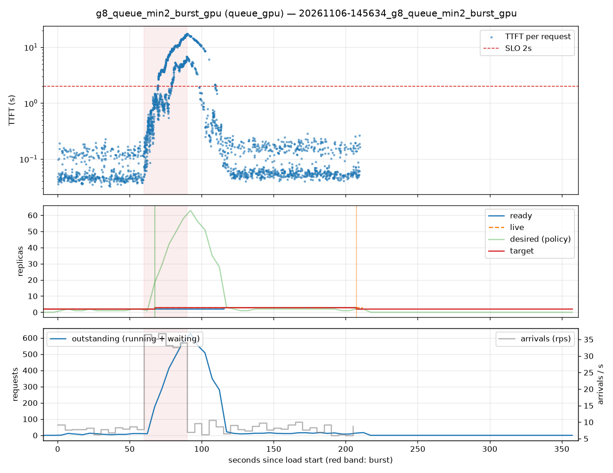

# g8_queue_min2_burst_gpu (queue_gpu)

Run `20261106-145634_g8_queue_min2_burst_gpu`, git `?`, valid: **True**

| Phase | Rate | Requests | OK | TTFT p50 | TTFT p95 | TTFT p99 | Within SLO |
|---|---|---|---|---|---|---|---|
| 0 | 8 rps | 471 | 471 | 50ms | 156ms | 187ms | 100% |
| 1 | 34 rps | 1042 | 1042 | 3.23s | 14.65s | 16.52s | 45% |
| 2 | 8 rps | 968 | 968 | 80ms | 8.62s | 14.84s | 91% |

## Burst reaction

- Ready at onset: **2**; scale-ups during baseline: 0
- Detection: 7.28s; capacity ready: 55.43s (burst lasted 30s)
- Capacity arrived after the burst ended by: 25.43s

## Cost and activity

- Replica-seconds during load: **563**
- Peak outstanding: 627; scale-ups 2, scale-downs 1

